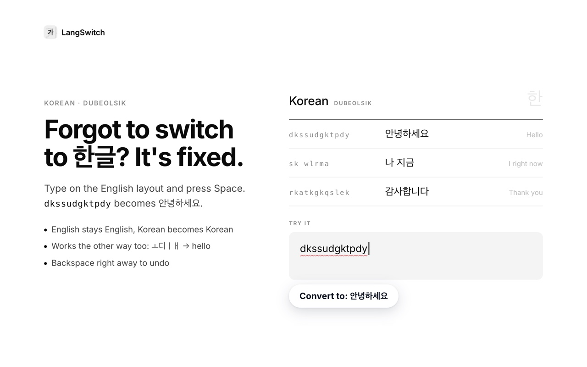
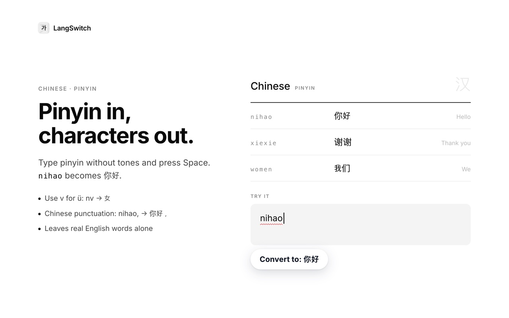
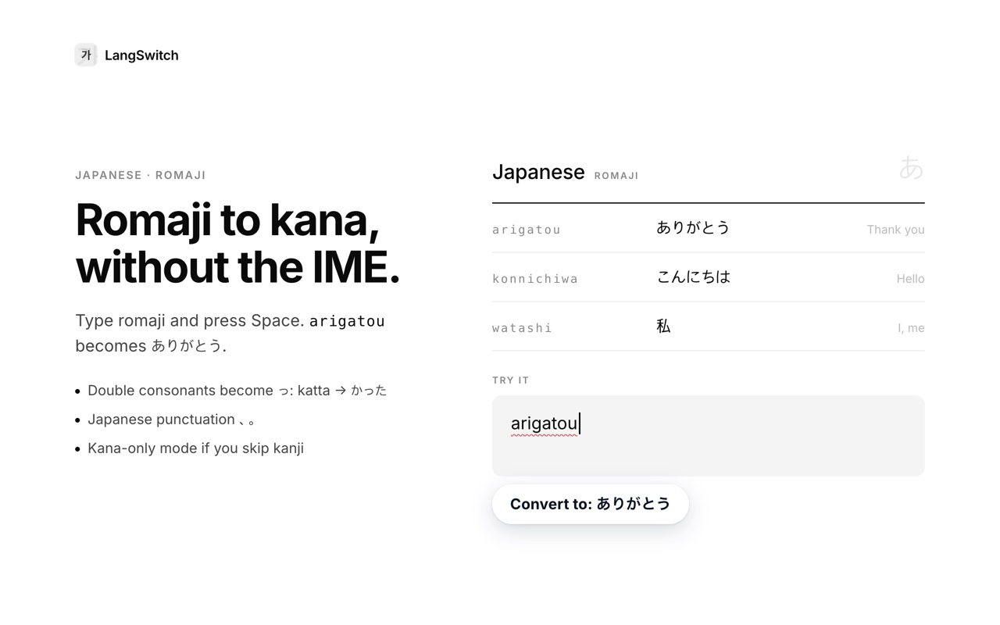
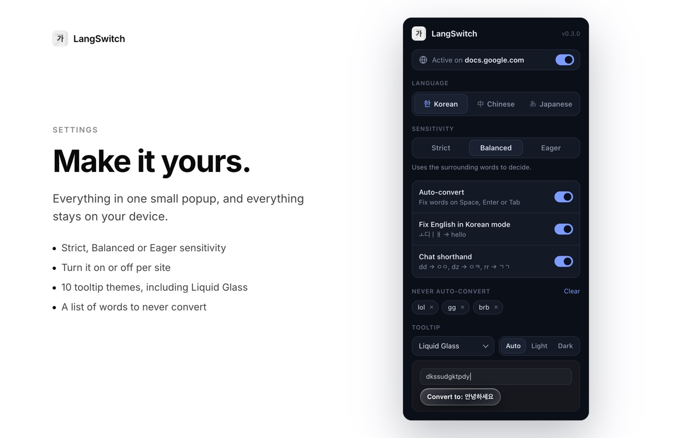

<div align="center">


# LangSwitch

**Wrong keyboard. Right words.**

A Chrome extension that fixes text typed in the wrong keyboard layout, as you type.


<br>
<br>



[Get started](#get-started) &nbsp;·&nbsp; [Languages](#languages) &nbsp;·&nbsp; [Privacy](#privacy)

</div>

<br>

Typed `dkssud` when you meant `안녕`? LangSwitch shows the fix while you type and applies it when you press **Space**, **Enter**, or **Tab**.

## Features

| | |
|---|---|
| **Both directions** | English keys become Korean, and English typed in Korean mode comes back: `ㅗ디ㅣㅐ` → `hello`. |
| **Reads the sentence** | English stays English and Korean stays Korean. Words that could be either, like `so` / 내, follow the words around them. |
| **Easy undo** | Press Backspace right after a conversion to get your text back. Undo the same word twice and it won't convert again. |
| **Your call** | Strict, Balanced, or Eager sensitivity, and an on/off switch for each site. |
| **Looks right** | 10 tooltip themes, including Liquid Glass, in light, dark, or auto. |

## Languages

| | You type | You get |
|---|---|---|
| **Korean** · Dubeolsik | `dkssudgktpdy` | 안녕하세요 |
| **Chinese** · Pinyin | `nihao` | 你好 |
| **Japanese** · Romaji | `arigatou` | ありがとう |

- **Korean** also handles chat shorthand like ㅋㅋ, ㅇㅋ, and ㄱㄱ.
- **Chinese** takes pinyin without tones. Use `v` for `ü` (`nv` → 女), and punctuation converts too (`nihao,` → `你好，`).
- **Japanese** takes Hepburn or Wāpuro romaji, doubles consonants into っ (`katta` → かった), and has a kana-only mode.

<details>
<summary>Screenshots</summary>
<br>






</details>

## Get started

1. Download or clone this repository.
2. Open `chrome://extensions` and turn on **Developer mode**.
3. Click **Load unpacked** and pick the folder that contains `manifest.json`.
4. Open the LangSwitch popup and choose your language.

Then type one of the examples above in any text field and press **Space**.

> [!NOTE]
> Instagram and Discord start paused while their editors get proper support. You can turn them on from the popup, but conversions there may not stick.

> [!TIP]
> In chat apps, **Enter** sends your message before LangSwitch can convert the last word. End with a Space if it needs fixing.

## Privacy

Everything runs on your device. What you type is never sent anywhere, and password fields are never touched. Settings and your never-convert list are stored in the browser.

<details>
<summary>Permissions</summary>
<br>

| Permission | Used for |
|---|---|
| `storage` | Settings and the never-convert list |
| `tabs` + `activeTab` | Knowing the current site for the on/off switch |
| Host access | Reading and fixing text fields on web pages |

</details>

## Development

There's no build step. After editing, click **Reload** on `chrome://extensions` and refresh the page you're testing.

```sh
node tests/detector.test.js              # accuracy per scenario
node tests/detector.test.js --verbose    # list every wrong word
```

To try it without installing, serve the repo and open the test pages:

```sh
python3 -m http.server 8000
```

- [`tests/playground.html`](http://localhost:8000/tests/playground.html): the real content scripts with a mocked Chrome API
- [`tests/editors.html`](http://localhost:8000/tests/editors.html): real Lexical (Instagram) and Slate (Discord) editors, with each editor's own text shown

<details>
<summary>How Korean detection works</summary>
<br>

Each word gets two scores: how much it looks like Korean (common syllables, known words, particles and endings) and how much it looks like English (everyday words count far more than rare dictionary entries). The words around it and what you've been typing on the page tip the balance.

When a word converts, the one or two words before it are checked again, so a short first word gets fixed once the sentence makes its language clear. The test suite types Korean, English, and mixed sentences in both directions, including sentences outside the word lists.

</details>

<details>
<summary>Project layout</summary>
<br>

| Folder | Contents |
|---|---|
| `scripts/` | Conversion, language detection, text field handling, tooltip themes |
| `ui/` | The popup |
| `data/` | Dictionaries and word lists |
| `assets/` | Icons and store screenshots (`render.js` regenerates them) |
| `docs/readme/` | The demo animation (`make_demo.py` regenerates it) |
| `tests/` | Detector tests and browser test pages |

</details>

<br>

<div align="center"><sub>Less retyping. Keep going.</sub></div>
