<div align="center">


# LangSwitch

**Wrong keyboard. Right words.**

Fix your typing without switching layouts or starting over.


<br>
<br>



[Get started](#get-started) &nbsp;·&nbsp; [Languages](#three-ways-to-type) &nbsp;·&nbsp; [Privacy](#stays-on-your-device)

</div>

<br>

Typed `dkssud` when you meant `안녕`? LangSwitch catches it while you type and suggests a fix. Turn on auto-convert to apply it with **Space**, **Enter**, or **Tab**.

## The everyday stuff

| Feature | What it does |
|---|---|
| **Fix the layout** | Convert English keys to Korean, pinyin to Chinese, or romaji to Japanese. |
| **Go both ways** | Turn English typed with the Korean keyboard back into English: `ㅗ디ㅣㅐ` → `hello`. |
| **Take it back** | Press Backspace right after a conversion to undo it. Undo a word twice and it won't auto-convert again. |
| **Choose how much it helps** | Pick Strict, Balanced, or Aggressive detection, and enable Korean slang when you need it. |
| **Choose where it runs** | Pause it on individual sites from the popup. |
| **Make it fit** | Choose from 10 tooltip themes, including Liquid Glass, with light, dark, or automatic appearance. |

## Three ways to type

| Language | You type | You get |
|---|---|---|
| **Korean · Dubeolsik** | `dkssud` | 안녕 |
| **Chinese · Pinyin** | `nihao` | 你好 |
| **Japanese · Romaji** | `arigatou` | ありがとう |

**Korean** composes Hangul from English keys and supports common slang such as ㅋㅋ, ㅇㅋ, and ㄱㅅ. It uses the surrounding words to help distinguish Korean from English.

**Chinese** accepts pinyin without spaces or tone marks. Use `v` for `ü`, as in `nv` → 女. Punctuation converts too: `nihao,` → `你好，`.

**Japanese** accepts Hepburn and Wāpuro romaji, including doubled consonants: `katta` → かった. Turn on **Kana only** for hiragana instead of kanji. `arigatou.` becomes `ありがとう。`.

<details>
<summary>See it in action</summary>

### Korean


### Chinese


### Japanese


</details>

## Why I made this

It's easy to start typing and only then notice the wrong keyboard is on. LangSwitch is for those moments—fix the words and keep going.

## Get started

1. Download or clone this repository.
2. Open `chrome://extensions` in Chrome.
3. Turn on **Developer mode**.
4. Click **Load unpacked** and select the `LangSwitch` folder containing `manifest.json`.
5. Open the extension popup and choose your language.

Try an example from the table above in a text field. With auto-convert enabled, press **Space** to apply the suggestion.

> [!NOTE]
> Instagram and Discord start paused. You can enable them from the popup, but their editors may behave differently from regular text fields.

## Stays on your device

Conversion runs locally. Your typing and page content aren't sent to a server. Settings and your never-convert word list are saved in the browser.

<details>
<summary>Why it needs browser permissions</summary>

| Permission | Used for |
|---|---|
| `storage` | Saving settings and the never-convert word list. |
| `tabs` + `activeTab` | Checking the current domain for the per-site toggle. |
| Host access | Detecting and converting text in fields on web pages. |

</details>

## For contributors

No build step is needed to load the extension. After editing it, click **Reload** on `chrome://extensions` and refresh the page you're testing.

```sh
node tests/detector.test.js
node tests/detector.test.js --verbose
node tests/detector.test.js --all-modes
```

For a browser playground without installing the extension:

```sh
python3 -m http.server
```

Open [the playground](http://localhost:8000/tests/playground.html) to try the real content scripts with a mocked Chrome API. [The editor test page](http://localhost:8000/tests/editors.html) tests Lexical and Slate and shows their internal text models. You can also use `demo/index.html` with the extension installed; local files require Chrome's **Allow access to file URLs** setting.

<details>
<summary>How Korean detection works</summary>

Each word is scored as both Korean and English. The detector considers common syllables, known words, Korean particles and endings, and everyday English vocabulary. It also checks nearby words and the language recently typed on the page.

Ambiguous input such as `go` / 해 follows its sentence. After a conversion, the previous one or two words are checked again with the new context.

The test suite covers Korean, English, and mixed sentences in both directions, including sentences outside the word lists.

</details>

<details>
<summary>Where things live</summary>

| Folder | Contents |
|---|---|
| `scripts/` | Conversion, language detection, field handling, and tooltip themes. |
| `ui/` | Extension popup and settings. |
| `data/` | Local dictionaries and word lists. |
| `assets/` | Icons and screenshots. |
| `tests/` | Detector tests and browser playgrounds. |
| `docs/readme/` | Animated README artwork; no scripts or external assets. |

</details>

<br>

<div align="center"><sub>Less retyping. Keep going.</sub></div>
