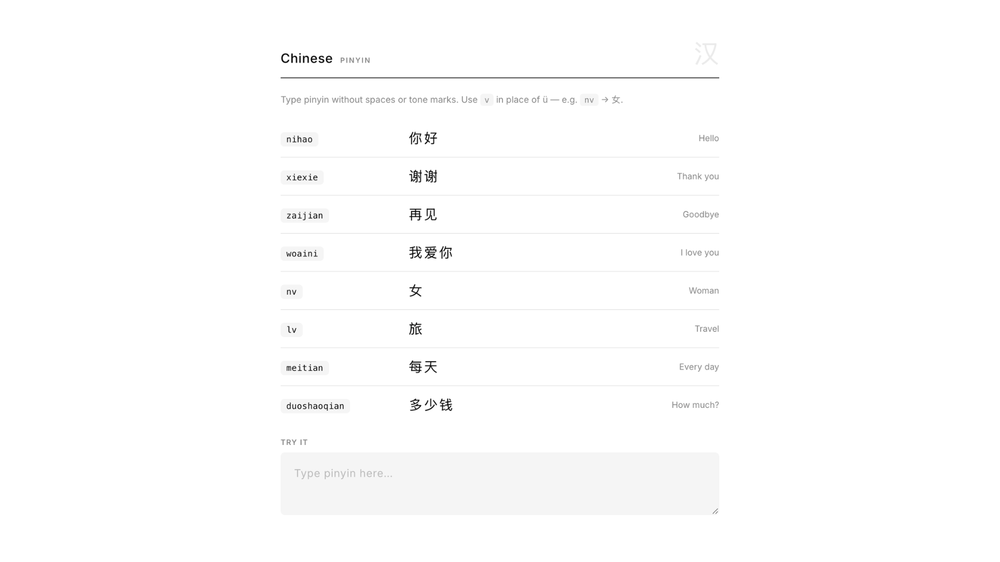
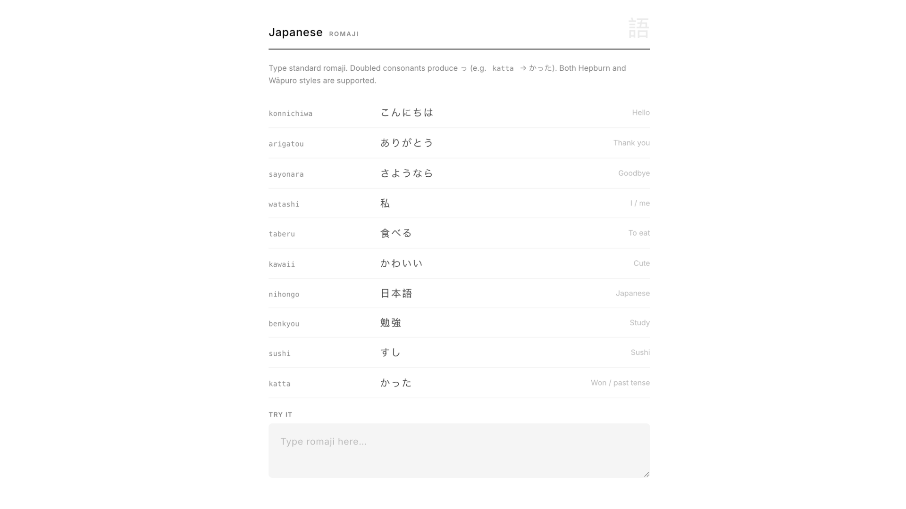
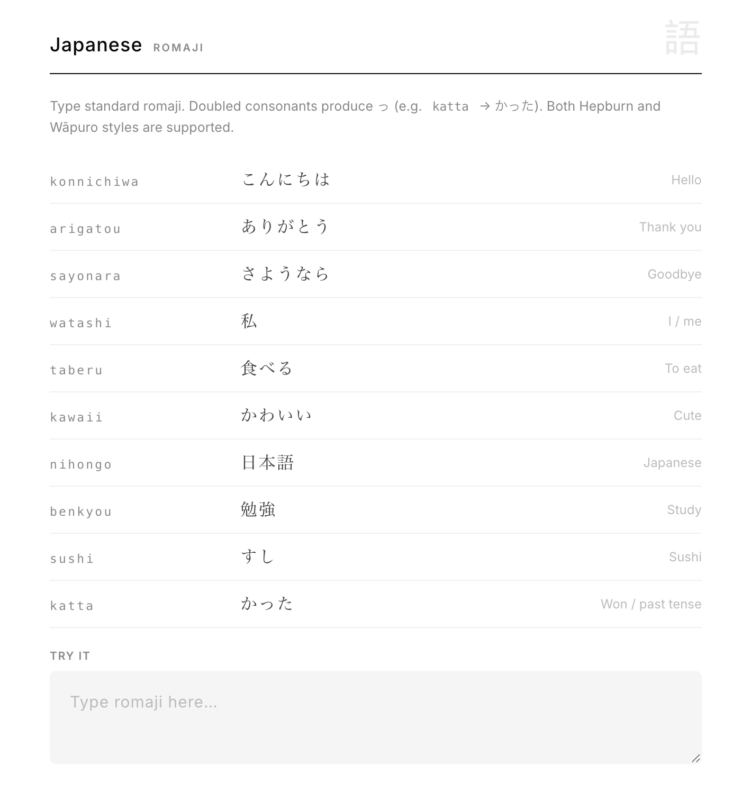

# LangSwitch

A Chrome extension that detects mistyped keyboard-layout input in text fields and suggests local conversion. Supports Korean, Chinese, and Japanese typing workflows and runs fully locally.


## How It Works

Type naturally with your keyboard. LangSwitch detects when your input looks like a mistyped layout and shows a suggestion tooltip. With auto-convert on, the fix is applied on `Space` / `Enter` / `Tab`.

For Korean, each word is scored as Korean *and* as English before anything changes:

- **Korean evidence**: how common its syllables are, whether it is a known word, and whether it ends in a particle or verb ending (학교**에서**, 공부**했어**)
- **English evidence**: everyday words count far more than the long tail of rare dictionary entries
- **Context**: the words around it, plus the language you've been typing on the page recently

Ambiguous words like `go` / 해 or `so` / 내 follow the sentence they're in. When a word converts, the one or two words before it get re-checked with the new context, so a short first word (`sk` → 나) is fixed as soon as the sentence makes its language clear.


## Languages

### 🇰🇷 Korean (Dubeolsik)

Type English keys as if your layout were Dubeolsik. LangSwitch composes the correct Hangul syllables and recognises common Korean slang (ㅋㅋ, ㅇㅋ, ㄱㅅ, etc.).

It also works the other way: English typed while the Korean IME is on (`ㅗ디ㅣㅐ ㅈㅐ깅`) is turned back into `hello world`.




### 🇨🇳 Chinese (Pinyin)

Type pinyin without spaces or tone marks. Use `v` in place of `ü` (e.g. `nv` → 女, `lv` → 旅) just like standard Windows IME input.

Typing `,` `.` `?` `!` right after a word converts it and adds Chinese punctuation (`nihao,` → `你好，`).




### 🇯🇵 Japanese (Romaji)

Type standard romaji. Doubled consonants automatically produce っ (e.g. `katta` → かった). Both Hepburn and Wāpuro styles are supported.

Punctuation works the same way (`arigatou.` → `ありがとう。`), and **Kana only** spells words out in hiragana instead of kanji (`watashi` → わたし).




## Features

- Suggestion tooltip
- Auto-convert on `Space` / `Enter` / `Tab`
- Reverse conversion for English typed in Korean mode (ㅗ디ㅣㅐ → hello)
- Undo with `Backspace` right after a conversion; a word undone twice is never auto-converted again (manage the list in the popup)
- Context modes `Strict`, `Balanced`, `Aggressive`
- Korean slang mode (ㅋㅋ, ㅇㅋ, ㄱㅅ, ㄱㄱ, ...)
- Per-site enable / disable rules (Instagram and Discord start paused for now; switch them on from the popup)
- 10 tooltip themes with a live preview, including Liquid Glass with real edge refraction in Chrome
- Light / Dark / Auto appearance; in Auto, Liquid Glass matches the page behind it

## Privacy

All processing is local. No keystrokes, no content, and no data of any kind is sent to external servers.


## Setup

1. Go to `chrome://extensions` in Chrome
2. Enable **Developer mode**
3. Click **Load unpacked** and select the `LangSwitch` folder

## Quick Test

1. Load `demo/index.html` with the extension active
2. Select a language in the popup
3. Type a phrase from the reference table and press `Space`

Without installing the extension, serve the repo (`python3 -m http.server`) and open `/tests/playground.html`. It runs the real content scripts with a mocked `chrome` API. `/tests/editors.html` does the same inside real Lexical (Instagram) and Slate (Discord) editors and shows each editor's own text model, which is what the app would actually send.

### Detector tests

```bash
node tests/detector.test.js            # accuracy per scenario
node tests/detector.test.js --verbose  # list every wrong word
node tests/detector.test.js --all-modes
```

The suite types Korean, English and mixed sentences word by word (including held-out sentences outside the word lists) in both directions and reports how many words ended up in the intended language.


## Project Structure

```
LangSwitch/
├── manifest.json
├── assets/
├── scripts/
│   ├── converter.js      # key ↔ Hangul / pinyin / romaji conversion
│   ├── detector.js       # Korean vs English scoring model
│   ├── themes.js         # tooltip themes (shared with the popup preview)
│   └── content.js        # field handling, auto-convert, undo, tooltips
├── ui/
│   ├── popup.html
│   ├── popup.css
│   └── popup.js
├── data/
│   ├── english-words.txt   # large dictionary (weak evidence)
│   ├── english-common.txt  # everyday English (strong evidence)
│   ├── korean-words.txt    # common Korean words (evidence, keys derived at runtime)
│   ├── korean-dict.tsv
│   ├── chinese-dict.tsv
│   └── japanese-dict.tsv
├── demo/
│   └── index.html
└── tests/
    ├── detector.test.js
    ├── editors.html
    └── playground.html
```


## Permissions

| Permission | Reason |
|---|---|
| `storage` | Save user settings and the never-convert word list |
| `tabs` + `activeTab` | Read current domain for per-site toggle |
| Host access | Detect and convert input on any page |


Add a `LICENSE` file before release MIT is recommended.
